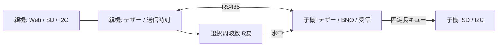

# 仕様・検証条件

## 親機校正セット・PPS観測時刻（2026-10-25）

親機のSpresense IMU・LIS3MDL・GNSSに共通の校正セットと観測単位ログを追加する。操作は既存のセンサー校正タブ。詳細と制約は[親機校正セット](parent_calibration.md)、ログ配置は[binary_log.md](binary_log.md)。姿勢・位置推定フィルタ自体の新規実装は含まない。

受け入れ条件：

- D02はPPS入力専用。実パルス・GNSSラベルの連続条件で対応成立し、未接続/異常周期/失効/非GNSS時刻を未同期として扱う。GPIO捕捉時計とUARTタイマーの起点を混同しない。
- IMUの内部カウンタ周回を展開し、各行に連番・read時刻・サンプル推定時刻・PPS対応UTC・品質・時計世代・親機セット番号/sessionを記録。未測定の遅延不確かさを0としない。IMUサンプリング位相のハードウェア同期とは区別する。
- 磁気は新規観測単位で連番/読出し時刻/生値/補正値を保存。NAV-PVTも受信連番/時刻/観測iTOWを保存し、既存HEALTHやUBXを維持する。
- セットは機体/各センサ識別名・CAD版・FRDの配置/回転・個別校正参照を持つ。未設定を下書きと表示し、非有限値/不正四元数を拒否。個別校正変更・通信失効を一致と表示しない。
- 保存は親機の安全停止・測距/個別校正停止・カード利用可能時のみ。応答中のSpresenseが記録中なら拒否。TMPのCRC/同期/読戻し後に新規BINへ確定し、失敗時は適用値を維持。起動復元とログ先頭へのセット複製を行う。
- 375px/1280pxで横はみ出しなし。編集を定期更新で上書きせず、通信途絶時は保存禁止。既存5タブと個別校正を維持する。
- ホスト試験、新旧デコード、Pico親子とSpresense両コアのビルドを実施する。実機同期・保存負荷・精度は別途記録し、未測定を合格としない。

作成日: 2026-09-20。対象はPico 2 W搭載P_MAIN/C_MAIN。本番候補の統合検証中。

## 実接続

ユーザー申告: 親子USB・RS485テザー・TX/RX基板・両振動子は接続給電済み。十数cmの容器内で振動子間は数cm、水中。Spresense電源OFF。親機温度・水圧センサとLCDは未接続。
USB旧ファーム応答: COM6親機、COM3子機。子機BNO/温度/圧力/SDは応答あり。親機は旧ファームでSD MOUNT_FAILED。これを新コードの合格結果と混同しない。

## 受け入れ条件

|機能|合格条件|確認方法|
|---|---|---|
|起動・ピン|P_MAIN/C_MAINの役割識別、Spresense GP7出力なし、無給電時周辺初期化なし|設計対照・USB状態|
|測距周期|許可後通常1秒周期、10/50/100/200 kHz×5波、観測中休止、停止時無送信|USBシーケンス＋波形実測（波形は装置が必要）|
|測距異常|受信なし・基準信号欠落・負ToF・エッジ溢れを正常距離にしない。近接は参考距離表示|状態テスト＋実機|
|周波数設定|4周波数の選択・送信停止後適用、異常値拒否|オフラインUI/ホストテスト＋実機波形（未実施）|
|マルチパス|選択枠の受信後1〜5秒の包絡線・エッジ、後続送信休止、欠損明示|状態/バイナリテスト＋実機SD帯域（未実施）|
|保存形式|全新規ログbinary、CRC・長さ確認、旧CSV保持|C++/Python読出し・破損/切断テスト|
|距離精度|既知距離で遅延校正後に合意した誤差以内|今回の数cm容器では未検証、許容誤差未決定|
|センサ|接続センサが有限値を継続報告。不在時ゼロ正常表示しない|USB/API/ログ|
|テザー|CRC確認、親機基準オフセット推定、3秒無通信で失効、再起動セッション区別|ホストテスト＋実機|
|ヘルス|親子SD同期済み行数・エラー・漏水入力・IMU・受信状況をWeb表示。通信断で未知表示|API＋Web|
|BNO50/100 Hz|定周期の予定時刻と実取得時刻を記録、取りこぼし/古い値を明示。連続60秒でレートと欠落を確認|SD読戻し解析|
|SD|新規ファイルの512 byte読戻し一致、短書込み/syncエラーを検出、既存ログ保持|実機＋CRC解析|

## 周波数・マルチパス記録・バイナリ保存（2026-10-09）

親機Webの「測距・マルチパス記録の設定」から10 / 50 / 100 / 200 kHzを選択できる。5波の有限PIOバーストと起動時送信OFFを維持する。設定ボタンは送信を停止してから適用し、再開は送信開始ボタンで行う。再起動で200 kHzへ戻る。各周波数での回路・振動子の応答、音響出力、距離精度は未検証。

マルチパス記録の初期値はユーザー指定の「音響受信後3秒・30送信枠に1回」。Webで1〜5秒、無効／毎回／5／10／30／60／300枠に1回を選べる。最初の送信枠と設定変更後の最初の枠を観測対象にする。子機は対象送信前にADC DMAを準備し、最初の音響受信後の包絡線を20 kSa/s、比較器エッジをµs時刻付きでSDへ保存する。搬送波そのものの波形ではない。受信なし・SD停止・ゲイン確認中などの実行不可も状態・終了理由へ残す。

対象送信から観測秒数＋0.5秒の間、親機は後続の音響送信を休止して反射に別送信が混ざるのを防ぐ。通常の音響送信は1秒周期のままで、休止後は次の送信枠から再開する。テザー状態通信・IMU取得は継続する。今回、測距回数の増加と符号化は実装しない。

新規のIMU・BNO全イベント・ヘルス/測距・時刻/位置・マルチパス記録をすべてAQBIN001の `.bin` に変更した。ファイル／レコードのバージョン、CRC32、時刻、種別、長さを付ける。既存CSVを変換・削除・上書きしない。Webは新binと旧csvを回収できる。通信version=3・156 byteへ変更したため親子の両方を更新する。

詳しい仕様・フィールド・PCでの読出しは [バイナリログ形式](binary_log.md)。`python scripts/decode_binary.py ファイル.bin --csv-dir decoded` で種類別CSVへ展開できる。既存のverify_imu_log.py／verify_raw_log.pyは新binと旧csvを扱う。USB回収のdump_log.pyはバイナリ中の文字列に依存せず、ファイル長で読み出す。

20 kSa/sの3秒分は生ADCで120000 byte。書込みブロック化と間引きで負荷を抑えるが、実機SD帯域と連続動作は未測定。サンプル番号・欠損数・ADCエラーを保存し、未取得を連続データとして扱わない。観測中はADCを専有するためボタン／通常ENV値は直前値、漏水デジタル入力とI2Cは継続する。

API: `POST /api/range/config/<hz>/<seconds>/<every>`（X-Aqua-Control: 1、送信停止中のみ、every=0で観測無効、API上限300）。設定は親機が受理し、次のSCHEDULEで子機へ通知する。保存状態はremote.observation_active / observation_samples / observation_lost / observation_skippedで確認する。新規ログ名と設定はstatusに表示する。

子機SDの正常状態を確認できない枠は観測対象にしないため、既存のゲイン確認（子機SD停止）には観測用の送信休止を挿入しない。

## テザー受信基準の片道音響測距（2026-10-09）

親機は既存のRS485 DATA線に開始マーカー（0x00）を送る処理と、選択周波数×5波のPIO送信開始を同じアラーム処理で実行する。子機は事前のCRC付きSCHEDULEを受けて待機し、UART0 RX（GP1）の最初の立下りを割込みで記録する。マーカーの1バイト受信を確認してから、そのエッジを測距基準として採用する。音響コンパレータ（GP2）の6 µs以上のHIGHの開始時刻との差を、子機の単調時計だけで計算する。

`ToF_us = 子機の音響受信エッジ_us − 子機のテザー受信開始エッジ_us`
`距離_m = ToF_us × 1500 / 1000000`（片道なので2で割らない）。音速は暫定値で温度・塩分補正は未実装。

200 µs未満も非負なら近接・未校正の参考距離を表示する（range_state=2）。200 µs以上はrange_state=3。負値、22 ms窓の範囲外、基準信号欠落、エッジ溢れ、RESULT期限切れは取得異常（4）で距離はnull。音響エッジなしは1、比較器HIGHで有効エッジなしは5。マーカー待ちは受信したSCHEDULEから500 msで打ち切る。

相対時刻同期が未成立でも測距は実施する。PROBE/REPLY/SCHEDULEの相対同期はUTC配信・状態監視のため維持するが、ToFにはoffsetや推定同期不確かさを使用しない。通信version=3で旧version=1/2を拒否するため、親機と子機の両方を更新する必要がある。

基板変更・専用トリガ線追加は行わない。include/pins.hのGP0/GP1、親機GP16、子機GP2を隣接AquaBeaconのbuild_parent_main.py/build_child_main.pyと照合済み。実配線は既存のユーザー申告を前提とし、今回の物理確認は未実施。親機GP6/GP7の役割は変更しない。

「同時」は同一処理内の起動指示であり、UART開始とPIO出力の完全な同時性を保証しない。テザー伝搬・RS485変換・割込み・TX/RX回路の遅延は未校正。短距離では音波がテザー信号より先に検出される可能性もあり、そのエッジを正常距離にしない。表示値は受信差に基づく未校正参考値で、実距離精度は未検証。

新規保存はバイナリへ変更し、CSV展開時には主要列名を維持する。tx_usは両機とも「子機のテザー受信開始エッジ」に意味を変更し、rx_usは子機音響受信エッジ、tof_usは両者の差。RESULTのt1は親機送信予定時刻（診断のみ）、t2は子機音響受信、t3は子機テザー基準、uncertaintyは0（校正精度を意味しない）または0xffffffff（取得異常）。APIのranging_methodはtether_edge_one_way、range_calibratedはfalse。

実機では親子USBのシリアル番号と役割応答を確認してから両機を書き込み、親機Tで送信開始、Xで停止する。ユーザーがWebで近接距離、基準信号欠落、既知距離での表示を確認し、測定器でGP16とRS485 TX/RXの遅延を測る。PCのWi-Fi切替、SDフォーマット、既存ログ削除は行わない。

## 定周期保存

core1でBNOをポーリングし、50 Hz=20000 µsまたは100 Hz=10000 µsの固定グリッドに記録行を作る。core0が512行キューを取り出しSDへ書き、1秒ごとにsyncする。SD SPIは子機4 MHz、親機1 MHz。予定時刻を書き換えて取りこぼしを隠さない。遅延が1周期以上なら飛ばした予定枠をカウントして先へ進む。
`fresh_mask`: bit0姿勢、bit1加速度、bit2角速度、bit3地磁気の新規イベントが当該枠で取得されたこと。地磁気は20 Hz。`source_us`は姿勢イベントのSH-2 timestampで、全チャネル同時刻を意味しない。
同じ値を再利用した行もあるため、行数だけでセンサの実サンプル数としない。`imu_gaps`はセンサ種別ごとの8 bitイベント連番から求めた、実際のBNOイベント欠落数だけを示す。固定100 Hz枠で姿勢/加速度/角速度の新規更新が揃ったかは`fresh_mask`、予定枠の飛びは`index`と`scheduled_us`で別に判定する。

## 制約

- 漏水電極LOWを20ms継続で検知。断線は乾燥と区別できず、実際に濡らす試験は別途必要。
- RXエッジ検出だけで「音響受信成功」と断定しない。近接容器の反射、回り込みの切分けが必要。
- RTCはOSFが立つ場合は時刻無効。RTCのバックアップ保持試験は今回の必須項目外。
- Spresense連携は旧P_MAIN_experimentで継続可能。今回の統合プロファイルでは未実装・未検証。
- I2Cセンサ再接続は再起動が必要。BNO再初期化はUSB `r`（初期化中の予定枠遅延を伴う）。SDはUSB `s` で復帰可能。

## 根拠

- ピン: `../../AquaBeacon/pcb/build_child_main.py` PICO1 (C-MAIN v4.5系)、build_parent_main.py、BRINGUP_BOARDS.md の実配線。GP7はSpresense受信。
- センサ: CHILD_MAIN_test/src/i2c_devices.cpp を基に未接続除外・RTC OSF判定を追加。
- 測距: TD04A_test/TD04A_test/common/aquabeacon_config.h の200kHz、5波、初期しきい値300mV、早期反応200µs。
- [Pico SDK公式API](https://www.raspberrypi.com/documentation/pico-sdk/hardware.html)
- [CEVA BNO08Xデータシート](https://www.ceva-ip.com/wp-content/uploads/BNO080_085-Datasheet.pdf)

## BNOライブラリの扱い

Adafruit BNO08x 1.2.5をlib/に同梱。SPI初期化の待ち時間は維持し、通常ポーリングはINTがLOWの時だけsh2_serviceを呼ぶ。アプリ側のSH-2 callbackでSHTP内の全イベントを処理する（getSensorEventは同じパケット内の最後のレポートしか返さない）。専用コピーではSPI HALの`t_us`とHAL時計をmicros()で設定し、ゼロ基準の時刻を修正した。初期のSPI read即時復帰変更は不具合のため撤回済み。

SPI HAL内の第2INT待ちとリセット時の設定はブロックし得る。実測遅延/予定枠欠落を必ず評価し、ハードリアルタイムの保証とはしない。

## 全イベント保存と停止

固定グリッドのC_MAIN_IMU_100Hz_xxxxx.binとは独立に、BNOの全コールバックをC_MAIN_BNO_EVENTS_xxxxx.binへ保存する。センサID・8bit連番・SH-2再構成時刻・ホスト取得時刻・各軸をCRC付きで保存し、後からセンサ別の欠落を検査できる。姿勢/角速度100 Hz要求時の実測は約100.21 Hz、加速度約125.97 Hz、地磁気20 Hz要求時は約25.05 Hz。要求レートと内部の実レートを区別する。

USB `q` はproducerを停止→キューをdrain→全ログsync/close→STOPPEDの順序で停止する。core1は取得・ヘルス通信を続ける。`s` で新規ファイルを作って記録再開。USB読戻しは送信済みバイト数を確認して未送信分を保持し、PCはブロック単位で受信する。

測距RESULTが予定窓の終了から50ms以内に届かない場合は取得異常とし、前回の距離を最新測定として表示しない。

本番投入前の残課題: 既知距離での電気/音響遅延校正、同期不確かさの外部基準測定、漏水刺激試験、センサ抜差し/故障復帰、長時間耐久と電源断・SD満杯試験。テザー受信差だけで精密距離を保証しない。

追加検証: [SD停止・再開と親機への状態反映](../reports/2026-09-20_002_sd_health_lifecycle/README.md)を確認。物理的なSD抜去や故障とは区別する。

## USB受信ゲインモニター
`python scripts/gain_monitor.py` を起動し http://127.0.0.1:8777 を開く。開始ボタンで60秒間、親機は既存の1Hz・5波送信、子機はSDを停止してENV_ADCを100 kSa/sのADC DMAで取得。20 ms窓の最小・平均・最大を表示する。電圧は3.3V基準の未校正ADC入力換算値で音圧ではない。比較器状態と累積エッジ数、既存の測距判定も表示。終了時は親機X、子機n/sでADCを停止してSD記録を再開する。子機mはSD停止中のみ有効、nで停止、75秒でも自動ADC停止。自動停止だけではSDは再開しない。生データはreports/raw/gain_live.json。USB受信時刻で横軸を表示し、各窓の子機時刻t_usも保存する。距離精度は未検証。ユーザーが配線修正後に近接受信を確認し、水槽から離すと検出なしになることを確認した（ユーザー実施）。

## 追加の確認条件（2026-09-20）
ユーザー指示により距離精度の検証は今回の対象外。配線修正後の早期反応、および水槽から離した際の検出なしをユーザーが確認。近接での受信動作はこの申告に基づき記録し、精度合格とはしない。親機LIS3MDLは未接続のため今回の検証対象から除外。親機SDカードは挿入済み。BNO正常フラグは姿勢・加速度・角速度の全てが3周期未満で更新された場合に成立する。子機地磁気はBNOの更新が150ms未満の場合のみ有効とし、古い値・未取得値はnullとする。

## 実験ごとの新規ファイル
起動時、およびUSB qで停止してsで再開すると、未使用の連番ファイルを新規作成する。既存ログは追記・上書きしない。記録中のs単独や測距Tだけではファイルを切り替えない。
親子をまとめて区切るには `python scripts/new_experiment.py` を実行する。USB個体と役割を確認し、両機q→STOPPED確認→両機s→新ファイル名を確認する。切替中は短い記録中断があり、両機の切替時刻は厳密に同時ではない。測距の開始/停止状態は変更しない。失敗時はエラーを出し、保存再開を試みる。出力されたファイル名の組を実験の対応表として使う。各種類の連番は独立のため、番号が一致するとは限らない。
新規SD保存はAQBIN001のバイナリ。各レコードにCRC32、時間値は原則µs単位。UTCの有効性は時刻源フラグで判断する。Cは子機固定周期IMU、Iは全BNOイベント、Dは子機センサー/ヘルス/測距、Qは親機センサー/ヘルス/測距、Pは親機時刻・端末位置、VのBINは512バイトSD読戻し確認用。

## 固定Wi-Fi・長いファイル名・起動動作
SSIDはAquaBeacon-MAIN、パスワードは[APパスワード非公開]で固定。使用中のSdFatはUSE_LONG_FILE_NAMES=1、ファイル名バッファは64バイトとし、ASCIIの説明的な名前で保存する。
- C_MAIN_IMU_100Hz_00000.bin（50Hz版は50Hz）: 子機の定周期IMU
- C_MAIN_BNO_EVENTS_00000.bin: 子機の全BNOイベント
- C_MAIN_HEALTH_RANGE_00000.bin: 子機センサー/状態/測距
- P_MAIN_HEALTH_RANGE_00000.bin: 親機センサー/状態/測距
- P_MAIN_TIME_POSITION_00000.bin: 親機の単調時刻・参考UTC・時刻源・スマホ位置と精度（1秒周期）
既存の短い名前のログはそのまま残す。ファイルごとに未使用の連番を選び、排他的な新規作成で上書きを防ぐ。日付はUTC未成立のため名前に使用しない。Vxxxxx.BINは検証用として従来どおり。
起動時、Wi-Fi/APは自動開始。周辺電源検出後にセンサー初期化・新規SDファイル作成・定周期保存・テザー通信を自動開始する。USB端末から開始コマンドを送る必要はない。測距送信は起動時OFFで、親機USB Tで開始、Xで停止。今回の依頼では起動動作の確認のみ行い、送信自動開始への変更はしていない。USB給電と周辺電源は別で、周辺電源がなければセンサー/SDは開始しない。

## Webで完結する実験操作
親機APの http://192.168.4.1 に接続。USBやPC常駐サーバーは不要。SSID AquaBeacon-MAIN、パスワード [APパスワード非公開]。
1. 「新しい実験・記録開始」で親子の旧ログを同期停止し、新規ファイルで記録を開始する。
2. 「測距送信を開始」で1Hz送信。「測距送信を停止」は記録を続けたまま送信のみ停止。
3. 「実験終了・親子の記録を停止」で送信と親子保存を停止。各機器の停止状態を確認する。
4. 「SDログの回収」で親/子を選択し一覧を取得、バイナリログ（旧CSVも可）をダウンロードする。転送中止可能。子機転送は115200bpsテザーと固定長フレームに制限され、大容量では時間がかかる。ブラウザは回収データをメモリに保持するため、非常に大きなログはSD直接回収を推奨。
5. 「親子の記録を再開」で新規ログを作る（既に保存中の機器は継続する）。
6. 「記録設定」で子機50/100Hz切替、新しいログで再開。設定はRAM上のみで電源再投入時はビルド既定値（現個体100Hz）。BNO再初期化も記録停止/再開と組み合わせて操作できる。
7. 「受信ゲインの確認」で60秒のピーク/平均グラフを表示。子機SDを停止してADC100kSa/sを集計し、テザーで取得。ユーザーが可変抵抗を手で調整する。通常終了時は子機SDを再開。ブラウザが切れても親機のテスト送信は60秒で停止し、子機Webモニターは75秒で停止・保存再開を試行する。
通常の測距開始ではブラウザを閉じても送信を継続する。停止操作は画面から明示的に行う。電源投入時の送信OFFは維持。

実装: 固定長156バイトのCONTROL/CONTROL_REPLYフレームを追加。SD処理はcore0、テザーはcore1。子機は直前のセッション/要求番号と応答を保持して再送時の二重実行を抑止。ACK完了またはエラーをHTTPへ返す。記録停止はキュー排出・sync完了を待つ。親子の一括操作は順番に行うため、厳密な同時切替や原子的な成功を保証しない。部分失敗は画面に表示し、各機器の状態確認を促す。
GETは状態/画面取得。操作は専用ヘッダー付きPOSTのみ。ログ回収は記録停止中のみ。ファイル名のパス移動を拒否、転送オフセットとサイズを検査。既存ログ削除/フォーマット機能は提供しない。

ユーザー指示により、このPCのWi-Fiを切り替える検証は行わない。切替を含む旧テストスクリプトは実行禁止。実機画面の操作確認はユーザーが行う。

GitHub Pagesの操作画面: https://ry32767.github.io/P_MAIN_experiment/main-control/ 。親機HTTPは https://ry32767.github.io のOriginのみ外部アクセスを許可し、OPTIONS・専用操作ヘッダーに対応。対応ブラウザではローカルネットワーク許可が必要。公開画面を先に開いて保存後、機体Wi-Fiに接続する。今回PCのWi-Fiは切り替えない。

## 電池残量の表示

親機・子機ともユーザー申告の11.1 V / 2200 mAh / 50C / 24.42 Whを標準3S LiPoとして扱います。既存INA226の電源電圧から、10.5 Vを0%、12.6 Vを100%とした線形の目安を5%刻みで表示します。これは実測容量の割合ではありません。50Cは残量計算には使用しません。10.8 V以下を低電圧表示にする暫定設定で、自動停止はしません。

電圧未取得、周辺電源未検出、6 V未満（USB給電など）、12.9 V超では残量不明とします。子機通信が3秒以上途絶した場合、または親機への状態取得に失敗した場合も残量を消します。電池の放電曲線・温度・負荷補正は未校正で、残り時間や残りmAh、各セル電圧は推定しません。定電圧電源の場合も電圧目安になるため、電池の残量とは解釈できません。

表示方式の参考：[INAVの電圧ベース残量計算](https://github.com/iNavFlight/inav/blob/master/src/main/sensors/battery.c)。閾値は今回の表示用の暫定設定で、当該電池メーカーの保証値ではありません。

## Spresense・GPS時刻同期の状態表示

2026-09-20の通電開始に伴い、親機GP6でSpresense D02の1PPS、GP7でD01のAQB1 UART（115200 bps・受信専用PIO）を受信します。外付けGNSS用GP8/GP9は使用しません。既存Spresenseファームウェアは変更不要です。

WebはSpresense通信、GPS測位成立、測位使用衛星数、1PPS検出と周期、GPS時刻の有効性、親機とUTCの対応、Spresense SD/IMU状態を別々に表示します。現在のAQB1データには可視衛星数・信号強度がないため、未測位時の電波受信有無は「不明」とします。通信途絶時は過去の測位状態を現在値として表示しません。

UTC対応は、1PPSと有効UTCの連続3組、約1秒の周期、UART受信が直前PPSの20〜800 ms後という既存実験の条件を利用します。時刻ラベルが直前PPSに対応すること・絶対時刻精度は未検証です。APIの`spresense.sync_candidate`で条件成立を示し、`utc_candidate_us`は参考値です。従来の`utc_valid=false`は精度未検証として維持します。GPS通信は3秒、同期は1.5秒の期限で失効し、画面も更新停止3秒で不明表示になります。

子機のテザー相対同期はUTC配信に残し、測距は子機のテザー受信エッジと音響受信エッジの差を使用します。今回UTCを子機へ配信したり、既存SDログの時刻をUTCに変更したりはしません。旧予約ファイルは後述の時刻・位置ログに置き換えました。

## スマホからの位置・時刻共有

1. スマホで[GitHub Pagesの操作画面](https://ry32767.github.io/P_MAIN_experiment/main-control/)を開き、親機へ接続します。ブラウザーが親機への通信を許可できる環境が必要です。
2. 「スマホから位置・時刻を共有」を開き、「時刻共有を開始」または「位置・時刻共有を開始」を押します。位置を使う場合はブラウザーの位置情報許可が必要です。端末の日時は自動設定を使用してください。
3. 画面を開いている間、約30秒ごとに更新します。他の実験操作中・画面が非表示の場合は更新を延期します。共有停止で親機の時刻・位置参照を解除できます。SD保存済みデータは残ります。

位置はこの画面を開いている端末の位置で、親機そのものの位置とは限りません。GPS・Wi-Fi等のどの方式で取得したかはブラウザーから判別できません。位置取得に失敗しても時刻共有は継続します。HTTPの親機内蔵画面は通常位置情報APIを利用できませんが、時刻だけの共有は可能です。HTTPSのGitHub Pagesを利用してください。

時刻には`Date.now()`による端末時計を使用し、位置取得時刻をGPS時刻とは扱いません。往復通信の中点に相当するUTCを親機の単調時刻に対応付けます。往復1秒超や送信中の端末時計変化は拒否。表示する往復時間は通信指標であり、絶対時刻誤差の保証ではありません。時刻は最終プローブから3分、位置は取得から1分で失効します。再起動時は消去されます。

記録用UTCの優先順位はSpresenseのUTC対応候補→有効な端末時計→未同期。Spresense自身の時計や子機の時計を変更せず、子機とのテザー相対同期はUTC配信に残し、測距は子機内の受信時刻差へ変更しました。絶対UTC精度は未検証です。

親機SDが正常なら、毎回新規の`P_MAIN_TIME_POSITION_00000.bin`等に1秒ごとに親機単調時刻、参考UTCミリ秒、時刻源、端末時刻の更新経過、通信往復時間、スマホ位置と精度、CRC32を保存します。以前の`P_MAIN_GNSS_RESERVED`の新規生成は廃止し、既存ファイルは保持します。時刻未取得はUTC値0と`time_source=none`、位置失効は有効フラグ0とNaNです。位置は親機へ直接送信し、この画面のコードはGitHub等へ送信しません。

実装根拠：[W3C Geolocation](https://www.w3.org/TR/geolocation/)（位置の取得元、HTTPS・許可、取得時刻の意味）。

## 親機SDの復旧（2026-09-21）

先行検証ではWRITE_FAILED後の再マウントで復旧し、時刻・位置ログとヘルスログ各172行のCRC32が一致しました。根本原因は未特定のため、復旧機能は接触・電源・媒体の問題を解消するものではありません。

親機は保存失敗時、5秒、15秒、60秒の待機を挟んで最大3回、自動再認識します。毎回512バイトの新規ファイル読戻しを検証し、新しい番号のログで保存を再開します。旧ログの削除・上書き・フォーマットは行いません。復旧後30秒連続で正常なら試行上限をリセットし、短時間で繰り返す故障では無限に再試行しません。失敗から復旧までの記録は欠落し、後から埋め戻しません。

Webの「親機SDの復旧」で、子機なしでも親機だけの復旧・記録再開と停止ができます。上限到達後も復旧ボタンで再試行可能です。正常保存中の復旧ボタンは新しいファイルを作らず、そのまま継続します。「親機の記録・自動復旧を停止」や従来の記録停止は自動復旧も無効にします。USBのs/qも同様です。安全停止時にSDエラーが出た場合でも自動再開は抑止されますが、保存成功を意味しません。

`sd_recovery`には有効/待機/上限到達、連続試行回数、自動復旧成功累計、最後の失敗理由を表示します。既存のSDエラー累計も保持し、復旧成功で過去のエラーを隠しません。起動時は自動記録・自動復旧が有効になります。今回の改良は親機限定で、子機は接続・書込みしていません。

## 子機BNO085ログのSD復旧（2026-09-22）

子機のIMU・全BNOイベント・ヘルスログも、書込み・同期・マウント失敗後に5秒、15秒、60秒で最大3回再マウントする。各試行では新規512バイトファイルの書込み・同期・読戻し一致を確認し、成功時だけ既存ファイルを上書きせず新しい番号の3ログを開始する。復旧前に失われたキューデータは欠落カウンタへ加算し、補完しない。30秒連続成功後に試行上限をリセットする。

`q`は復旧を無効にしてキュー排出・同期・クローズし、`s`は復旧を再度有効にして新規ログを開始する。USB状態JSONは`sd_recovery.enabled/waiting/exhausted/attempts/recoveries/last_failure`を返す。今回の変更は子機ビルドだけへ書き込み、親機実機は操作しない。

## 親子UTC同期・RTC保持（2026-09-21）

時刻源は有効なGPS PPS候補 → Wi-Fiで接続したスマホ/端末の時計 → DS3231 RTCの順。機体内Web画面を開くと端末時計を約30秒周期で共有する。位置情報は従来どおり明示操作。AP単体はインターネット時計を取得しないため、スマホ/PCの自動日時設定が必要。PCのWi-Fi切替は行わない。

UTCは取得・測距用の単調時計を変更せず、別の基準時刻として管理する。親機は既存の相対同期後、空き時間に同じ156バイト長のUTC_ANCHORフレームを送る。子機は親子offsetで基準の単調時刻を変換し、UART受信遅延をUTCへ加えない。セッション・要求番号・相対同期を検査し、4秒で受信基準を失効。無通信時は子機自身のRTCへ戻る。混在する旧ファームはUTCを扱わないため両機を更新する。

RTCはI2C0の0x68、SDA GP4 / SCL GP5。取得後の初回・時刻源変更・10分ごとに保存し、読戻しで確認。失敗時は5秒以上空けて再試行する。OSF（発振停止履歴）、BCD、日付、2020–2099年の範囲を検査し、無効なRTCを時刻源にしない。電池動作中の発振を有効化する。RTCは秒単位で書込み、位相・絶対精度は保証しない。電源断保持には有効なバックアップ電池が必要で、ソフト再起動試験と物理電源断試験を区別する。仕様根拠：[DS3231公式データシート](https://www.analog.com/media/en/technical-documentation/data-sheets/DS3231.pdf)。

子機の定周期IMUと全BNOイベントのバイナリへutc_us/utc_sourceを追加。未同期は0/none。ヘルスのバイナリへUTC基準の単調時刻・epoch・有効期限・時刻源を追加。親機の時刻ログにも実際の選択時刻源を保存。時刻源変更や校正でUTCは飛ぶことがあるため、経過時間・サンプリング評価はscheduled_us/acquired_usを使う。GPS候補・端末時計・RTCを混同しない。

Web/USBはutc.valid、source、rtc_valid、rtc_writes、rtc_write_errorsを表示。子機のUTC・RTC状態を親機ヘルス経由でも表示する。utc_validは基準時刻を利用可能という意味で、絶対精度の校正合格ではない。共有停止は端末からの更新停止であり、既存RTCとSDログは消さない。

GPSフレームのPPS後下限は20msから2msへ変更。64バイト/115200bpsの転送は約5.56msで、実機は約10–16ms後に届くため旧条件では排除されていた。上限800ms、PPS周期、連続3エポック、時刻有効性の検査は維持。PC/NTPとの粗い照合と外部パルスによる高精度校正は別。

USB診断（通常実験では不要）：FはGPSの選択を90秒だけ除外、Gは診断除外を解除、Jは親機のUTC配信だけ15秒停止。自動解除され、状態utc_testに表示する。BはSDがSTOPPEDかつ転送中でない場合に限りソフト再起動する。F/Jは通信・PPSそのものを物理遮断する試験ではない。

検証コマンド：`pio run -e parent -e child100`、`python scripts/test_host.py`。実機書込みは`python scripts/flash.py parent` / `child100`（個体と役割を照合して安全停止後に書込み）。

## BNO085校正と親機コンソールのタブ（2026-10-10）

- 内蔵Webを状態／実験・測距／センサー校正／時刻・位置／ログ・SDの5タブへ分割する。停止ボタンと結果は全タブ共通。矢印/Home/End、aria-selected、対応するtabpanel、単一の表示パネルを用いる。既存API・既存操作・状態表示のIDを保持する。公開Pagesは別リポジトリのため今回更新しない。
- 子機限定のCONTROL操作13=CAL_START、14=CAL_STATUS、15=CAL_SAVE、16=CAL_ENDを追加。既存1〜12と156バイトフレーム長を維持。親機での同操作はUNSUPPORTED。エラー8=IMU_ERROR、9=CAL_NOT_READY。親子のファームウェア更新が必要。
- 開始は測距送信停止→子機SDのキュー排出・sync・停止確認→校正。変更操作は子機が停止済み、停止処理なし、受信モニターなし、リセット要求なしの場合のみ受理する。状態照会だけは記録中も許可する。周辺電源なしやBNO初期化失敗はIMU_ERROR。
- BNO/SH2は既存所有者のcore1でのみ操作する。core0は要求ID付きキューを介して完了応答を待ち、遅延応答はIDで排除する。テザー要求の重複は既存キャッシュで二重実行を抑止。ベンダーライブラリのget/setCalConfigとsaveDcdNowへ750msの応答期限を追加する。同期SH2呼出し中はcore1のテザー処理に短い空白が生じるため測距を停止する。core0のHTTP・SD処理は待ちループで止めない。
- 開始前の動的校正マスクを取得・保持し、加速度+磁気の動的校正を有効化。ジャイロは静置校正、磁気は校正中だけ50Hzへ増やす。開始後の各レポートstatus&3を状態0〜3として表示する。最終取得500ms未満の加速度・ジャイロ・磁気が全部2以上で5秒継続した場合だけ保存可能。これはCEVAの手順へ追加した保存条件で、角度精度の実測判定ではない。Game Rotation Vector、姿勢座標系、既存バイナリ形式は変更しない。
- DCD保存成功はsh2_saveDcdNowのSH2_OK応答で判断。1セッションの成功後の再保存を拒否し、失敗時は再試行可。保存先はBNO内部フラッシュ。SDへ校正値を保存しない。未保存での終了はRAM上の補正の巻戻しを保証せず、既存のBNO自動保存設定は変更しない。
- CAL_ENDは開始前マスクと磁気20Hzに戻す。両方成功したときだけ校正中フラグを解除し、失敗時はフラグを維持して明示終了の再試行を可能にする。10分で自動終了を試行。BNO再初期化/リセット検出で当該セッションの表示状態を破棄する。終了でSD記録を自動再開しない。
- 子機校正中は記録再開・周期変更・Webからの再初期化・受信ゲイン開始をBUSYとして拒否。Health flagsのbit15をCALIBRATINGとし、UTC源bit12〜13と分離。親機は子機の最新REPLYにこのフラグがあれば音響送信を抑止し、Webからの測距開始も拒否。子機も校正中のSCHEDULEを受理しない。USBの直接リセットはセッションを破棄する診断操作として残る。
- CAL_STATUSはControl.data内の短いJSONでactive/saved/a/g/m/ready/errを返す。古いレポートは-1。校正タブ表示中のみ通常の状態ポーリング後に照会し、共有busyで操作の重複を防ぐ。3.5秒更新なし、HTTP失敗、子機通信失効では状態不明にする。

受け入れ条件：親機/子機50Hz/100Hzビルド成功、ホストで状態鮮度・継続条件・異常応答・保存重複・設定復帰の検証、オフラインで5タブ/停止失敗時の開始抑止/通信失効表示を確認。実機の校正開始・保存応答・再起動後の保持・角度精度は別途確認する。PCのWi-Fi切替・既存SDログの削除/フォーマットは禁止。

根拠：[CEVA BNO08X Sensor Calibration Procedure 1.6](https://www.ceva-ip.com/wp-content/uploads/BNO080-BNO085-Sesnor-Calibration-Procedure.pdf)、同梱lib/Adafruit_BNO08x/src/sh2.h・sh2.c。検証：[校正・タブUI](../reports/2026-10-10_001_bno_calibration_console/README.md)。

## 測距回数・簡易音響パターンと通信の排他（2026-10-10）

この節は従来の「通常1秒周期」「符号化を実装しない」「通信version=3・156 byte」を更新する。
親機コンソールの「実験」→「測距・マルチパス記録の設定」で1〜4回/秒と、単発（5波）／3連パターンを選ぶ。「送信を停止して設定を適用」の後、「測距送信を開始」で再開する。起動時は1回/秒・単発・200kHz、送信OFF。設定はRAMのみ。

3連は選択搬送波の5波を3回送信し、間に約1msと2msのLOW区間を入れる。PIOの次バースト準備に3命令周期を要するため、各開始間隔は `5/f + gap + 3/(4f)` 秒（gap=0.001 / 0.002）。子機は6〜600µsのHIGHを候補として、2つの開始間隔がそれぞれ±200µs以内で一致したときだけ採用し、最初の開始時刻でToFを計算する。単発では従来の6µs以上を維持。比較器の包絡線応答で波形が伸びることがあるため、許容幅は暫定で実測調整が必要。候補は64個まで、溢れは取得異常。最初の到来窓22msは維持し、パターンの残りの確認時間を追加する。

単発ノイズ・間隔不一致を除外するための簡易方式であり、反射を消す処理ではない。反射も同じパターンを持ち、直達波が弱い場合には反射を採用する可能性がある。3連のエネルギーは単発より増える。反射重畳・受信回路の回復・短距離での波形・消費電力・距離精度は未測定。完全な相関処理や伝搬遅延校正は実装しない。

親子通信は115200bpsの半二重RS485、音響は別経路。従来は1秒ごとにPROBE→REPLY（子機3ms待機）→SCHEDULE→100ms後に開始マーカー＋PIO送信→音響窓→RESULT。操作通信は測距後の空き時間、UTCは次のPROBEまで400〜650msの空き時間を選んでいた。今回は問い合わせ待ち・予約〜結果待ち・操作要求の完了待ちの間は次のPROBEを開始しない。操作要求中は進行中の測距を終えてから通信し、新しい測距を休止する。UART/DMA使用中には送信しない。子機のREPLYは送信受付に成功するまで保持する。開始マーカーを送るアラームもUART/DMA空きを検査し、使用中なら音響送信を行わない。UTCは問い合わせ／測距／操作の待ちがなく、次枠まで40ms超の空きがある場合に送る。

通常の回数は送信枠の設定であり、成功測距数や厳密な周期を保証しない。応答待ち・操作中・SD観測中に遅れた枠はまとめて連射せず、次の枠から再開する。PROBE応答待ちは200msで打切り、RESULTは予定送信＋受信窓＋パターン確認＋50msで取得異常。操作通信は5秒期限。実機でのRS485方向切替や突発遅延は未検証。

マルチパス観測の既定値3秒／30枠に1回は維持し、最初の送信も観測対象。観測対象から記録秒数＋0.5秒の間は音響を休止する。連続して設定回数を試すときは「マルチパス記録頻度」を無効にする。前回の反射が次枠に残る影響はこのパターンだけでは排除できない。

APIは `POST /api/range/config/<carrier_hz>/<seconds>/<every>/<rate>/<pattern>`、rate=1〜4、pattern=0単発／1三連。専用操作ヘッダー・送信停止中の条件は維持。旧3引数APIも受理し、rate=1/pattern=0になる。statusのranging_rate_hz/acoustic_patternで設定を確認する。USB Tは現在の設定で開始し、Xで停止する。

通信はversion=4・158 byteになり旧version=1/2/3を拒否するので、親子の両方を更新する必要がある。今回は実機へ書き込んでいない。ピンは変更せず、隣接AquaBeaconの基板生成コードとGP0/GP1・親機GP16・子機GP2を再照合した。実配線は既存のユーザー申告を前提とし今回の物理確認は未実施。

新規バイナリのHEALTH/SHOT末尾にu8のranging_rate_hz/acoustic_patternを追記。ファイルヘッダーversion=1を維持し、レコードの長さとCRCで識別する。更新したPC読出しツールは旧長さも扱い、旧ログは1回/秒・単発として読む。従来のPCツールは新長さを扱えないため更新が必要。既存ログは保持する。

## 毎回変わる音響パターンとテザー通知（2026-10-10更新）

この節は同日の固定3連パターンと通信v4の仕様を更新する。親機の既定を「1回/秒・毎回変わる3連・200kHz」に変更し、起動時の送信OFFは維持する。コンソールの実験タブで単発／毎回変わる3連を選べる。直近のパターン番号も表示する。従来の3引数設定APIは明示的に単発を選び、5引数APIのpattern=1は可変3連を意味する。

各バーストは5波、3バーストの2つの休止時間で64種類を表す。ID=0〜63について `gap1_us=1000+600*(ID%8)`、`gap2_us=7000+600*(ID/8の整数部)`。休止は1.0〜5.2msと7.0〜11.2msの別々の範囲で、600µsの刻みは受信間隔の±200µs許容帯が重ならないように選んだ暫定値。各開始間隔はPIOの準備時間を含め `5/f + gap + 3/(4f)` 秒。回路・水中での許容幅は未校正。

親機はセッション番号由来の初期IDから `(ID+17)%64` の順で予約し、64種類を一巡してから再使用する。通常の問い合わせや送信しない枠では進めず、送信予約とアラーム確保に成功した枠で進める。予約後に送信できなかった枠は欠番として消費する。停止・再開・周波数／回数／観測設定変更でもID列と使用履歴をリセットしない。同一親機起動中の各IDは予定送信時刻で16秒以上空け、足りなければその枠の音響を休止する。4回/秒で64枠を一巡する時間が16秒。再起動時は履歴が消えるので、直前の反射との区別を保証しない。16秒より遅い反射にも保証はない。

CRC付きSCHEDULEに測距番号・周波数・モード・パターンID・2つの休止時間を載せる。子機は有効なセッション／測距番号に加え、IDと休止時間が規定表と一致することを確認してからマーカー待ちに入る。信号の2つの開始間隔が通知されたパターンと一致した場合だけ最初の到来時刻を測距へ採用する。異なるパターン単独では採用しない。RESULTにもIDと休止時間を返し、親機は予約内容と一致しない結果を取得異常にする。最初の到来窓22ms、6〜600µsのHIGH候補、64候補上限を維持し、今回のパターン分の確認時間を延長する。

親子の半二重通信の排他・操作中の新規測距休止・マルチパス観測中の音響休止を維持する。4回/秒を連続して試す場合は観測記録を無効にする。最長パターンの確認延長は10kHzで18150µs。163 byteフレームの転送時間から計算した通常トランザクションの予定RESULT期限は221450µsで250000µsの枠より短いが、実機の周期を保証する値ではない。

前回などの異なるパターンの反射を区別する方式であり、今回の信号自身の反射は同じパターンなので除外できない。直達波が弱いと反射を採用し得る。複数の反射・ノイズの候補を組み合わせて期待間隔が偶然成立する誤検出も残る。全組合せテストは単独の別パターンと、非重畳の旧パターン後に今回のパターンが届く条件の検証で、任意の重畳波を排除する証明ではない。反射低減効果・受信成功率・距離精度は未測定。

通信はversion=5・163 byteへ更新し、親子両方の更新が必要。今回も実機書込みは行っていない。新規HEALTH/SHOTバイナリには従来のrate/patternに加え `u8 patternId, u16 patternGap1, u16 patternGap2` を末尾に保存する。更新したPC読出しツールは旧2種類の長さも読め、旧レコードのパターンID／休止時間は不明（null）として扱う。ファイルversion=1とCRC、既存ログ保持は維持する。ヘルス／statusのIDは直近の予約枠を表し、未送信や測距成功を意味しない。SHOTの状態と合わせて判断する。

## 2026-10-10 親機F9P GNSS・LIS3MDL

本節が過去のSpresense時刻源の記述に優先する。ユーザーはJ_GNSS1 UART/PPS接続・GNSS/LIS3MDL通電済みと確認。親機GP8/GP9のUART1（Arduino Serial2）でF9P NMEAを受信し、GP6でGNSS PPSを入力する。GP7は入力のままでSpresense UART受信・PPS連携を開始しない。Spresense本体のプログラムは変更しない。基板上でGNSS PPSとSpresense PPSは同一ネットなので、両方の出力を同時に接続しない。

UART速度は38400→9600→115200→230400→57600 bpsを受信なし3秒ごとに探索する。チェックサムが正しいNMEAを受信中は速度を維持する。GNSSへ設定コマンド・不揮発設定変更は送信しない。RMCのA状態・有効日付と秒ちょうどのUTCを採用し、直前PPSの2〜800ms後、PPS周期999000〜1001000µs、3秒連続UTCの条件でUTC候補成立とする。1.5秒で候補失効する。PPSとRMCの秒対応・タイムパルスのUTC設定・絶対精度は未検証で、1秒ずれの保証はない。時刻源の優先順位は親機GNSS候補→端末時計→DS3231。既存GPSソース番号1とgps_pps_candidateを維持し、子機のUTC配信形式を変えない。

API gnssはUART受信・速度・チェックサムエラー・PPS周期・UTC候補・衛星数を表示。spresenseは互換用の未取得値。WebのGNSS欄は親機GNSSを表示する。LIS3MDLは0x1C/0x1EでWHO_AM_I=0x3Dを確認し、設定書込み成功後に有効化。±4gauss・10Hz・BDU設定で新データを1秒周期でµT表示・HEALTH記録する。BDUは各軸の上位/下位バイトの更新混在を防ぐ。校正・方位精度は別途検証。親機温度/水圧/LCDとSpresenseは今回対象外。PCのWi-Fi切替はしない。

仕様根拠: [u-blox F9P Integration Manual](https://content.u-blox.com/sites/default/files/ZED-F9P_IntegrationManual_UBX-18010802.pdf) / [ST LIS3MDL datasheet](https://www.st.com/resource/en/datasheet/lis3mdl.pdf)。ユーザー申告NEO-F9Pの正確な製品型番は未確認。

## RTK・PPK対応（2026-10-10）

親機NEO-F9PをMON-VERで識別し、F9P確認後にRAM層へUART1 230400bps、RTCM3入力、UBX出力、RXM-RAWX/SFRBX/NAV-PVT出力を設定する。不揮発メモリ/BBRへ保存しない。CFG-VALGETで6項目を読み戻し、config_verifiedを表示する。実機のFWVERはHPGL1L5 1.40、PROTVER 27.40、MOD NEO-F9P。L1/L5の受信機なので、基準局・PPK処理も共通の信号を扱える必要がある。NAV-PVTのfixOKとcarrSolnから単独/Float/Fixedを表示し、3秒で不明にする。受信機のhAccは推定値で実測精度ではない。

時刻・位置タブで外部Wi-Fi（スマホテザリング等）、NTRIPホスト/ポート/認証をPOST本文で設定する。2026-10-25から、設定適用はRAMへ反映し、明示的な保存操作で親機SDのAQ_NTRIP_A.cfg/B.cfgへ接続情報とマウントポイントを保存できる。二つの設定スロットを世代番号とCRC32で検証し、非最新スロットへ書込み・同期・読戻し一致を確認する。途中書込みや破損時は有効な旧スロットへフォールバックし、両方無効なら現在値を維持する。保存は親機SD認識済み・記録停止完了・測距停止・転送終了時に限る。SDフォーマットやログ削除はしない。設定は平文相当のバイナリで暗号化しない。CFG拡張子は大文字小文字を問わずREAD_LOGから拒否し、ログ一覧にも出さない。起動後最初のSDマウント時だけ自動復元し、先にWebで適用した値とSD復旧時の現在値を上書きしない。復元後はWi-Fiを接続するが補正ストリームは手動開始。既存認証は同一ホスト/ポートで両欄空・keep_auth=1のときだけ保持し、同一SSIDでwifi_password空・keep_wifi=1のときだけWi-Fi秘密を保持する。接続先変更時は旧認証を引き継がない。初期候補は神戸・学園都市周辺を想定したntrip1.bizstation.jp:2101 / 3C722D56（無認証・現地RTKと精度は未検証）。親機はAP+STAとなりAPコンソールを維持する。PC Wi-Fi切替は行わない。NTRIP v1（HTTP/1.0・Basic認証）を実装。TLS、chunked、圧縮ストリームは未対応。接続は非同期DNS（5秒期限）とTCP最大2秒の段階処理、受信/送信は分割し、15秒無更新・切断で5/10/20/40秒、以後40秒待ち再接続。401等の接続拒否は自動再試行を止める。

基準局一覧STRのRTCM3・carrier=2・無圧縮・認証N/B・有効緯度経度を候補にする。手動は一覧またはマウントポイント名指定。自動選択は測位中の親機から100km以内の最寄り候補を選択する。信号L5の配信有無・局の品質・利用権限は一覧だけで保証しない。取得一覧上限256KiB、1行1023byte、表示は先頭64局。自動選択は取得した全候補を比較する。一覧未完了では自動開始しない。位置が未取得・失効時は自動選択しない。GNSSのチェックサム確認済みGGAを約10秒ごとに送信する。

RTCM3はCRC24Qを検査してから親機UARTへ転送する。無効フレームは除外。転送バッファ満杯では切断/再接続し、欠落カウンタを増やす。局変更/停止時は世代番号で旧局の未送信フレームを捨てる。途中送信済みの最大1フレームはフレーム末尾まで送る。補正接続とRTK解は別表示。補正が届いてもFixed成立や精度合格とはしない。

PPK保存は親機実験記録と連動し、毎回新規P_MAIN_GNSS_00000.ubx、.rtcm3、.jsonlを作成。UBXにはチェックサム確認済みRAWX（疑似距離・搬送波・ドップラー）、SFRBX（航法データ）、NAV-PVT、受信できたMON-VERをそのまま保存し、RTKLIB等へ渡せる標準ストリームとする。RTCMファイルは受信したCRC有効補正、JSONLは5秒ごとの単調時刻、UTC候補、GNSS状態、サービス/基準局名、アンテナ情報、保存数/欠落状況。認証情報やWi-Fiパスワードは含めない。アンテナ型番/高はコンソールで入力し、未測定高はnull。既存ファイルは保持する。停止はキュー排出後に同期/クローズ、再開は新規ファイル。RAWX/SFRBXの存在はPPK品質・精度を保証しない。

GNSSはcore1で最大4096受信byte/ループ、UART受信FIFO16384byte、UBX最大8192byte×8枠、補正最大1029byte×16枠を使用。core0がSDを所有してUBX/RTCM各4フレーム/ループを保存する。UARTのavailableForWriteは空きbyte数ではなく0/1なので、TXはhardware writableを確認し1byteずつ最大32byte/ループで進める。欠落・破損はカウンタとメタログで確認する。保存中のSD速度・ネットワーク実負荷での無欠落は未検証。

API: GET /api/gnss/stations、GET /api/gnss/config（現在の接続先・SSID・秘密の有無・保存状態のみ。ユーザー名/パスワード値は返さない）、POST /api/gnss/config（host,port,user,password,ssid,wifi_password,mount,keep_auth,keep_wifi）、/save（適用済み設定をSD保存）、/load（保存値を再読込み）、/table、/select（mount）、/auto、/stop、/antenna（antenna,height）。既存の操作ヘッダー/Origin検査を維持する。POST本文上限2048byte、HTTP要求全体4096byte。USB u=UBX、o=RTCM、k=JSONL回収（記録停止後）。scripts/dump_log.py --gnss ubx|rtcm|metaで回収可能。scripts/verify_gnss_ppk.pyはUBXの観測/航法存在・CRC・1Hz観測間隔を検査し、任意のRTKLIB convbinでRINEX3.04変換する。機体内Webのファイル一覧にも3種類を表示する。

PPK解析には同時刻・共通信号の基準局観測/航法データ、基準局の正確な座標・基準系、アンテナ情報、十分な衛星/搬送波観測が必要。今回の短時間サンプルだけでは精密解析の成立を認定しない。2026-10-25にPCから初期候補へのNTRIP v1無認証接続とCRC有効補正の受信、Galileo E1/E5aの信号欄を確認。親機実機でのNTRIP接続・補正RTCM転送・Float/Fixed・RTK精度・RINEX変換・PPK解算・実機Web・SD設定の電源断保持は未検証。ユーザーの補正サービス設定後に確認する。

根拠: [u-blox F9 HPG L1L5 1.40 Interface Description](https://content.u-blox.com/sites/default/files/documents/u-blox-F9-HPG-L1L5-1.40_InterfaceDescription_UBX-23006991.pdf)、[BKG NTRIP仕様](https://igs.bkg.bund.de/root_ftp/NTRIP/documentation/NtripDocumentation.pdf)。
## 親機LIS3MDLのコンソール校正（2026-10-10）

開始/保存/終了/補正解除をセンサ校正タブと操作ヘッダー付きPOST /api/mag/start|save|end|resetに追加する。状態はmag_calibration。開始時に測距と親機記録（PPK含む）を停止し、子機記録は継続。校正中は親機記録開始と測距開始を拒否、終了後は手動再開。最大3分・10Hz・1800点で3軸の生値を収集し、最小/最大中心と軸倍率を計算。20秒/200点、XYZ幅30〜200µT、8方向各5点、半径変動係数15%以下と目標平均半径85〜115%、新鮮で正常なデータ・飽和なし・有限な補正値を保存条件とする。飽和/通信失敗/古い磁気値を健康状態から除外する。

停止完了後にSDへ新規P_MAIN_MAGCAL_%05lu.binを排他作成、CRC32付き版1、同期/読み戻し成功後に適用。起動時に有効な最大連番を復元。解除も無補正の新規レコードで保持する。既存ログ削除/上書きは禁止。未保存終了は前の適用値を維持。補正後のXYZを既存MAG表示/ログに使用。軸間歪みの完全補正・方位角精度合格は対象外。Spresense変更なし、GNSS回転校正なし。詳細は[磁気校正](mag_calibration.md)。受け入れは合成3軸データの補正、回転不足/飽和/失効の保存拒否、CRC/版異常拒否、UI失敗表示、親子ビルド。実機の手動回転/保存/再起動保持と方位精度は別検証とする。

## Spresense 1線半二重通信（2026-10-11）

本節は過去の「GP7受信専用」「Spresense未変更/未取得」に優先する。GP7–Spresense拡張D03、共通GND、JP1=3.3V、追加4.7kΩなし、D02未接続で実装。GP6は親機GNSS PPS入力のまま。拡張ボードの既設1kΩプルアップを利用する。元のAquaBeacon/P_MAIN_experimentは変更せず、更新版ロガーをfirmware/spresenseに置いた。

1250bps・8N2のGPIO UARTで、両側はLOW出力/解放だけを使う。128byte CRC32・親機問い合わせ/応答・切替待ち・重複/古い要求拒否・3.2秒応答期限・5秒鮮度を実装。状態取得、親機の参考UTC配信、記録停止/新規ファイルで再開、停止完了後の再起動に対応。センサ校正タブに操作欄を追加した。HTTP202の受付とSpresenseの応答/操作完了は別。タイムアウトは実行結果不明として表示し、操作は同一セッション/連番/全ペイロードで最大2回再送し、Spresenseの応答キャッシュで重複実行を防ぐ。新しい連番で自動再送はしない。

PPS未接続のため通信時刻は参考値であり精度未検証。公称伝送遅延を補償して単調時計とUTCを対応付け、最大5秒で失効させる。IMU生データはIxxxxx.CSV、参考UTCアンカーはTxxxxx.CSVに記録。既存ログを保持する。Spresense内蔵GNSS/D01送信/D02出力は開始しない。

Sony公式校正手順を確認した。加速度6姿勢各10秒、重力値、ジャイロの緯度/地球自転・USB東向き等が必要。2026-10-11完成版では、6姿勢静止測定・加速度オフセット/倍率・地球自転を考慮したジャイロバイアスをソフトウェアで計算し、SDへ新規CRC付きレコードで保存/復元/解除する。IMU内部係数への書込みは行わない。生の値と補正後の値をログに併記する。Sony専用ツールの内部校正とは別方式で、実機の6姿勢測定と校正精度は未検証。

ビルドは ../P_MAIN_experiment/.venv/Scripts/pio.exe run と powershell -File scripts/build_spresense.ps1。ホスト検証は ../P_MAIN_experiment/.venv/Scripts/python.exe scripts/test_host.py。親機とSpresense MainCore/SubCore1への書込みを実施。実機操作・SD未認識などの結果はreports/2026-10-11_003_spresense_complete/README.mdへ記録する。GPIO波形・実負荷・実機Web・同期精度・実際の6姿勢校正は未検証。PC Wi-Fi切替を行わない。詳細は[Spresense通信資料](spresense_halfduplex.md)を参照。

## 内蔵HTTPの転送期限（2026-10-24）

接続開始からの一律7秒切断を廃止。受信または実際の送信バイトが7秒間進まない場合、または接続全体が120秒を超えた場合に終了する。TCP_NODELAYを有効にし、ループ当たり最大1460バイトを空き容量の範囲で送る。部分送信は残りを次回へ引き継ぐ。受け入れ条件は7秒超の画面転送完了、部分送信、送信0の失効、全体期限、millis周回の模擬試験。スマホ無線経由の表示成功とは区別する。

## 公開操作画面（2026-10-24）

GitHub Pagesのmain-controlを現行web/index.htmlに追従させる。公開版は全機体APIをhttp://192.168.4.1へ送り、明示接続とrole=P_MAIN確認後に端末時計を共有する。オンラインでは最新画面を優先し、通信不能時は専用キャッシュから表示する。PC Wi-Fiの切替と実機操作は公開検証に含めない。

親機USB `W` はWi-Fi/APとHTTPの読取り専用診断。AP起動結果、モード、IP、接続台数、待受、TCP受付・ルート受付・受信/送信バイト・完送・期限切れ累計、最後の返信コード/サイズ/送信位置、操作待機を返す。端末識別子・要求本文・認証情報は出力しない。GET /api/ping は通常のOrigin制限下で {"ok":true} を返し、記録/測距状態を変更しない。

GET / はWEB_PAGEの静的領域を参照し、sizeof(WEB_PAGE)-1をContent-Lengthに使用する。HTTPヘッダーと静的本文を同一送信位置で順に送り、ヘッダー/本文境界の部分送信でも重複・欠落を起こさない。本文サイズのStringを作らない。USB Wのresponse_bytesはヘッダー+本文の合計、heap_freeは診断時の空きヒープであり連続確保可能量ではない。

## Spresenseの保存診断（2026-10-24）

状態タブとセンサー校正タブにSpresenseの通信、IMUサンプル、欠落・キュー廃棄、SD書込み済み／同期済み行数、SDエラー累計、最後の障害段階・errno、復旧試行／成功回数を表示する。5秒の通信失効後は保存状態を不明とする。SD復旧は「SpresenseのSDを再認識・記録再開」で新規ファイルへ再開する。親子の記録操作とは独立している。

128byteフレームのpayload[88..103]を版マーカー0xD1付きSD診断に使用。従来この領域のジャイロバイアスは親機で未使用。旧ファームの診断は未取得として扱う。USBの状態JSONにもsd_rows / sd_synced_rows / sd_state / sd_failure / sd_detail / sd_attempts / sd_recoveries / imu_gapsを追加した。同期済み行数は両ログのfsync成功時点の累計であり、電源断耐性や欠落なしの保証ではない。

SpresenseはSDの認識、検査ファイル、ログ作成、ヘッダー同期、実書込み、同期、整形処理の失敗を区別する。ヘッダーも同期してから記録を開始。CSV整形の浮動小数点printfを固定小数の直接変換に置換し、列・小数桁・CRCの形式を維持する。共有バッファを2個にして、完了バッファのSD書込み中に別バッファのCSV整形を進める。各バッファはMainCore/SubCore1の片側だけが所有する。USB停止も親機と同じ完了確認経路に統合し、過去のSDエラー累計だけで正常な停止を失敗扱いしない。既存ログは保存し、SDフォーマットを行わない。960Hzの実保存継続・タイムアウトと欠落の実測結果は[検証記録](../reports/2026-10-24_004_spresense_sd_console/README.md)を参照する。実機Web表示はユーザー確認、PC Wi-Fi切替は行わない。

## SD自動復旧の検証方法（2026-10-24）

親機・子機のSdRecoveryとSpresenseSdRecoveryについて、復旧・短時間再発・5/15/60秒の待機・最大3回・30秒正常後の試行数リセット・明示停止中の再開抑止・手動再開・millis折返しを共通シナリオでホスト試験する。障害が継続して上限に達した場合は、媒体や接触を確認した後に再開操作が必要。障害中の欠落は埋め戻さない。

`parent_sd_recovery_test` / `child_sd_recovery_test` は明示選択する診断ビルドであり、通常ビルドに障害注入操作を含めない。診断ビルドのUSB `~` は有効確認、`!` は既存ログ同期後のソフトウェア模擬障害。実際のfailSd→待機→再マウント→新規ファイル作成→保存を検証する。カード抜去・電源断・物理信号断の試験とは区別する。

親機実機試験は `python scripts/verify_sd_recovery_device.py --raw reports/raw/<今回のフォルダー>` を診断版の書込み後に実施。USB個体番号とroleを確認し、2回の自動復旧、新規ログ名、同期済み行増加、停止後の両ログ読戻しとCRCを検査し、最後は記録を再開する。終了後は `python scripts/flash.py parent` で通常版へ戻す。子機未接続時には、子機の実機復旧を合格としない。

実測結果は[3機種のSD復旧確認](../reports/2026-10-24_005_sd_recovery/README.md)を参照。再起動や通常の停止・再開だけを自動復旧の証拠にはしない。既存ログの削除・上書き・フォーマット、PC Wi-Fi切替は行わない。

## Spresense SD再発防止（2026-10-24）

IMU取得と同時に1024/6000byteのSD書込みを行うとタイムアウトする条件を実機で再現した。SpresenseのwriteCompleteを、1回最大512byteかつ現在のファイル位置からセクタ境界を越えない書込みへ変更した。CSV形式、取得設定、校正・通信形式は維持し、エラーを握りつぶす再送はしない。今後のSpresense SD書込みもこの境界制約を守る。

対策版はIMU・通信タイマー併用で4MiBの書込み／全量読戻しを3回連続完了し、通常ロガーの300秒観測でもSDエラー・IMUエラー・欠落・キュー廃棄0を確認した。これは当該条件・時間での結果であり、SDK内部の最下層の機序や無期限の安定性までの合格ではない。RTK-GNSS別作業との競合を避け、親機USB・親機ファーム・GNSS設定は操作していない。[原因切り分けと検証記録](../reports/2026-10-24_006_spresense_root_cause/README.md)。

2026-10-25実機更新追記：D02へのPPS配線をユーザー確認済み。USBの`@SET STATUS`/`@SET SAVE`もWebと同じ安全条件を用い、未保存時は未確認配置の下書きを作る。保存・再起動復元をUSBで検証可能にする。

2026-10-25実機追従：LIS3MDLのdata-readyは10ms間隔で確認し、STATUS_REGをMAG有効フィールド上位へ記録する。内部変換の上書き検出を取得連番とは別に扱う。IMU時計は周波数更新時の位相連続性を保ち、曖昧な行を保留して再準備を繰り返さない。正常な実タイムスタンプの揺れを校正中の欠落へ誤加算せず、重複/過短/欠落相当を共通の周期窓で拒否する。

2026-10-25追記：親機core0のSD再準備中も、core1が保持する最新のGNSS PPSアンカーからSpresense用UTCとPPSラベルを直接生成する。古いUI/保存用UTCスナップショットの失効でセンサ側同期を解除しない。有効なGNSSがない場合の端末/RTCフォールバックと、明示GPS無効化の診断操作は維持する。

## 親機コンソール接続とSpresense SD形式（2026-10-25）

外部Wi-Fi開始後もAP+STAの管理状態を維持し、外部接続設定を空にした場合はSTAを切断してAP単独へ戻す。USB `W` で画面の要求/完送・ping・状態取得累計とAPモードを確認できる。ユーザーによるping・親機画面表示の復旧を確認した。

SpresenseのカードはFAT32を使用する。exFATは現行Sony SDKでは非対応。USB `v` は空き容量とカード先頭情報を読み取り専用で表示し、マウント失敗時の形式を確認する。カードの自動フォーマットや既存ログの削除はしない。今回のカードは実読出しでEXFATを確認し、安全停止済み。FAT32媒体での保存再開は未確認。

[接続復旧とSD診断の実測記録](../reports/2026-10-25_005_console_sd/README.md)。

## テザリング中のスマホからのWeb操作・RTK設定保存（2026-10-25）

テザリングを提供しているスマホからは、親機がテザリングで取得したIPアドレスを使って開く。`http://192.168.4.1/` はAquaBeacon-MAINに直接接続する場合のアドレス。時刻・位置タブとUSB `W` の `sta_ip` にテザリング側IPを表示する。IPはスマホのDHCP割当てにより変わる。スマホ側で接続端末への通信が制限される場合の到達性は実機確認が必要。

WebのOrigin検査は、実際のAPアドレス、接続中のテザリング側IP、既存のGitHub Pagesを許可し、任意の外部Originを許可しない。APアドレスは192.168.4.1を明示設定する。同じSSID・Wi-Fiパスワードの再適用では接続を作り直さない。変更したWi-Fiの接続開始はHTTP応答の送信完了後に行う。初回接続やWi-Fi情報変更では無線チャネルが変化する可能性があり、直接接続端末は再接続が必要になる場合がある。

「親機の記録・測距を停止してSDへ保存」は測距停止、親機記録の同期・停止完了を確認後、`POST /api/gnss/config` の `save=1` で入力設定の適用・SD保存・読戻し確認を一度の要求で実行する。停止失敗時は保存要求を送らない。記録停止・転送終了・SD認識のサーバー側条件も維持する。保存後は記録を自動再開しない。従来の `/api/gnss/save` は適用済み設定の保存APIとして維持する。保存失敗は成功と表示せず、RAM適用済み・未保存を通知する。二重スロット、CRC、秘密情報の非公開、既存ログの保持は維持する。

検証記録は reports/2026-10-25_006_tether_rtk_save/README.md。スマホからの到達性、実機SD設定保存・再起動保持、RTK成立と精度は別途実測が必要。

## 保存済みWi-Fiでの再接続と基準局一覧受付（2026-10-25）

スマホのテザリングをONにしてから「SDの設定を読み込んでテザリングへ接続」を押す。親機SDの保存値をRAMへ復元してWi-Fi接続を開始する。起動時の最初のSD認識でも復元する。補正受信は手動で開始する。Wi-Fi情報を変えなくても未接続時には接続を再試行し、HTTP処理の合間に30秒間隔で再接続する。接続済みの同じ設定は再接続しない。スマホ側設定・パスワード等が正しいことや到達性は別途必要であり、再試行は接続成功の保証ではない。

基準局一覧・自動選択・補正開始でWi-Fi名が未設定なら具体的な設定案内を返す。未接続時の有効な開始要求はWi-Fi再接続を予約する。NTRIP処理はWeb受付応答の送信後に開始する。画面は一覧取得・自動選択・開始・停止の同時実行を抑止し、応答中断時は処理の受付が不明であることを日本語で案内する。データ未着のHTTP接続は1秒で解放し、要求データ到着済み・受信途中・応答送信中の既存タイムアウトは維持する。接続状態・試行回数を画面とUSB診断へ表示する。

ホスト回帰試験は再接続の境界、millisラップ、接続済みの再試行抑止、空接続の解放と受信途中の保持、同時操作抑止を確認する。検証記録：reports/2026-10-25_007_station_fetch/README.md。Fetch Abortedの実機再現原因の断定やRTK精度の合格とは区別する。

### 接続待ちによるWeb停止の修正

導入済ドライバーのWiFi.beginNoBlockも、内部のCYW43::beginで接続を待っていた。プロジェクト内lib/lwIP_CYW43に導入済ソースのコピーを置き、STA接続要求の受付後に戻る方式へ変更する。共有フレームワーク・隣接リポジトリは変更しない。DHCPと接続完了は既存のポーリングで扱う。AP経路は元のまま。

NTRIPの名前解決は永続バッファと世代付きコールバックで非同期に行い、5秒で打ち切る。停止・設定変更・タイムアウト後の古いDNS応答を無視する。名前解決後のTCP接続待ちは200ミリ秒から2秒へ変更し、DNSと同一ループで待たない。接続後の送信タイムアウトは200ミリ秒へ戻す。状態取得のブラウザー待ちは5秒とする。名前解決失敗とTCP接続失敗を区別して表示する。TCP接続試行中は最大2秒の処理待ちが残る。無線チャネル変更やスマホ側のネットワーク切替に伴う切断まで無停止を保証しない。

AP先行起動時の既定経路も修正し、STAのDHCP成立後はテザリング側gatewayをインターネット通信へ使用する。非同期STA開始時にはLINK_UPをいったん解除し、実際のlink-up通知でDHCPを進める。

### 2026-10-25 現地RTK/PPK調査後の診断・保存改善
- GNSS信号設定（GPS有効/L1/L5、Galileo有効/E1/E5a）とDGNSS動作モードをRAMから30秒ごとに読戻す。読戻し自体では設定を変更しない。下記のGPS L5有効化のみRAMに適用する。
- NAV-SIGを5秒ごとに照会し、GPS L5追尾数・Galileo E1/E5a追尾数・同一衛星で2周波の位相を使用中の数を診断に表示。RXM-RTCMをUART1へ出力させ、受信機が補正を採用/不採用/不明とした件数を表示する。
- config_verifiedは通信・RAWX/SFRBX/PVT・RTCM入力/診断出力設定の確認であり、信号設定や位置精度の合格ではない。信号設定は60秒、衛星/補正診断は15秒を超えると不明/更新途絶として表示。未取得は0や無効に置換しない。
- PPK UBXにCFG-VALGET、NAV-SIG、RXM-RTCMを追加保存。衛星別のC/N0・補正元・位相使用フラグはNAV-SIG原文に保持し、JSONL/USB/Webには集計値を表示する。
- GNSS保存は64 KiBの可変長SPSCキュー。短いメッセージも8192 byte枠を消費していた旧8枠方式を置換。RTCM保存キューは16→32枠。GNSS排出は最大16件・継続4 ms目安（個別SD書込みの完了待ちは超過し得る）、RTCMは最大8件。
- キュー現在使用byte・起動後最大使用byte、セッション別の投入失敗RAWX/SFRBX/その他を記録する。従来のdroppedは排出時にSDへ保存できなかった場合も含み、種類別投入失敗と意味が異なる。既存ログは上書きしない。
- バッファ変更で欠落ゼロやFIX成立を保証しない。PCのWi-Fiを変更せず、実機Web確認はユーザーが行う。精度の改善は次回の屋外既知点試験で評価する。

- 追加の実機読戻しでGPS L5無効を確認したため、GPS/L1が有効・L5が無効と読戻せたF9Pに限り、初回補正送信前にGPS L5をRAM上で1回だけ有効化する。ACK/NAKと2秒期限を扱い、ACK後700 msは追加コマンド・補正送信を待機して再読戻しする。信号設定によるGNSS再起動を伴う。永続設定・他信号・衛星health判定は変更しない。有効化試行/ACK/失敗/読戻し確認は別々に表示し、ACKだけを成功扱いしない。

### 2026-10-25 テザリング接続のUSB診断
- USB W診断にCYW43の無線リンク状態・join状態・最終接続試行からの経過msを追加。一般のWiFi.statusだけでは接続先未検出/認証失敗/交渉中を区別できないための診断。
- USB行コマンド `@NET STATUS` は保存設定の公開項目と無線診断を返す。認証パスワードは返さない。`@NET REJOIN` はWeb応答処理の合間に保存済みRAM設定で再接続を予約し、ログは停止しない。
- 接続復旧時のSTA IPはDHCP割当て値を確認する。172.20.10.4に固定されるとは扱わない。

### 2026-10-25 RTK基準局の検索・前回受信局
- 「時刻・位置」の基準局一覧を、局名・配信先名・衛星システム・ネットワークで部分一致検索できる。全角英数を正規化し、空白区切りの複数語はすべてに一致する局を表示する。検索対象は取得した対応局の先頭64局。全件数と打切りを表示し、未掲載局は配信先名を直接入力する。最寄り自動選択は従来どおり取得全対応局を対象とする。
- 局名は場所等の説明、配信先名（マウントポイント）は接続ID。一覧の選択を配信先入力へ反映し、直接編集では異なる一覧選択を解除する。選択局の詳細と親機の使用中のサーバー・配信先を分けて表示する。未適用サーバーでの開始は画面で拒否し、設定適用へ案内する。
- 定期状態取得で選択欄を再生成しない。一覧はサーバー・ポート・一覧世代ごとに一度取得し、検索操作または新しい一覧のときだけ再生成する。取得失敗は5秒後に再試行する。定期更新中の検索語・選択・スクロールを保持する。
- 選択局の説明、衛星システム、ネットワーク、配信形式、配信メッセージ（一覧の公称値）、GGA要否、距離を表示。距離は更新中の親機GNSS位置と一覧座標からの球面概算であり、精密な基線長や位置精度ではない。親機位置の更新途絶時は測位待ちとする。
- 接続中のCRC検証済みGPS MSM4〜7（1074〜1077）の信号マスクと有効セルを調べ、L1/L5の信号情報をこのTCP接続中に受信したか表示する。MSMの更新が15秒途絶した場合・停止中は未確認／更新途絶とする。未検出を非対応と断定しない。搬送波有効性・受信機の補正採用・RTK FIX・実測精度は別である。再接続時に検出履歴をリセットする。
- CRC検証を通りGNSS送信キューへ投入できた最初のRTCMを受信成功の条件とし、接続情報を前回局として自動保存する。SDは専用二重スロット `AQ_LAST_A.cfg` / `AQ_LAST_B.cfg`（CRC・世代・同期・読戻し）を使い、設定保存の `AQ_NTRIP_*.cfg` と独立する。接続試行や失敗・単なる設定保存では前回成功局を更新しない。同一内容で再書込みしない。
- SD未認識・転送中・記録停止処理中・制御処理中は保存を保留する。正常記録中または正常停止済みSDへ親機メインループから小さい設定レコードを保存し、失敗は30秒間隔で再試行する。SD書込み・同期の完了待ちによる遅延とGNSS記録への実機影響は未検証。
- 前回局は起動後にSDから読み、現在の設定を自動で置換しない。「前回受信できた局へ再接続」でサーバー・ポート・配信先・認証・テザリング設定を復元し補正受信を開始する。保存完了／待ち／失敗を表示する。接続情報は暗号化しない。パスワード・ユーザー名はAPI応答やログダウンロードに出さず、CFGファイルを回収対象から除外する。
- 受け入れ条件：検索で該当局だけを表示する／一覧選択と接続入力が一致する／定期更新20回で選択欄とスクロールを維持する／破損した履歴スロットから前世代へ復帰する／再接続操作が保存先を復元する／位置・MSMの未取得を成功や非対応と誤表示しない。PCホスト模擬試験と375px・1280px表示で確認し、実機SD保存・再起動保持・接続・精度は別途確認する。
- 一次資料：[NTRIP STR項目](https://software.rtcm-ntrip.org/wiki/STR)、[RTKLIBのMSM信号ID表](https://github.com/tomojitakasu/RTKLIB/blob/master/src/rtcm3.c)。検証記録：`reports/2026-10-25_011_rtk_console/README.md`。

### 2026-10-25 コンソールの状態一覧・折りたたみ・3台のSD操作
- 状態の先頭に親機・Spresense・子機を独立した3枚のカードで表示する。親子の電池は従来の電圧推定、Spresenseの電池は通信項目がないため「計測情報なし」。カードにはSD保存状態と異常概要を表示し、押すと従来の詳細値を展開する。定期更新で開閉状態を変更しない。
- SD異常・低電圧・漏水・IMU未取得・記録欠落等は赤い枠/背景と説明文で表示する。親機のPPK保存欠落・GNSS UART欠落・磁気校正/セット復元エラー、Spresenseの校正エラーも概要へ反映する。累計カウンタは「累計」「履歴あり」と区別し、復旧しても起動中の過去エラーを消去しない。概要の原因は先頭2件と残件数、詳細には全件を表示する。
- 最初から未接続の機器は未取得、接続後に更新が途絶した機器は通信異常と区別する。正常停止した親機SDとSpresense SDを異常扱いしない。子機の通信データには詳細なSD停止理由がないため、停止中は「停止／未認識」と表示し、累計エラーを併記する。未接続の子機について電池・SD・校正の正常を表示しない。
- センサー校正は機器別の閉じた項目に整理し、開閉操作で展開する。「子機 BNO085」と明記。親機校正セットの配置・識別名等の入力欄を削除する。保存はPOST /api/parent-calibration/saveへreference_only=1を送り、適用中の個別校正番号だけを新規セットに記録する。既存の位置・姿勢・識別情報とversion=1/376byteの保存互換性は維持する。従来の入力APIも維持し、停止・カード等の保存ガードは変更しない。
- 時刻・位置は常時表示の測位/時刻源/PPK要約と、RTK接続・受信診断/PPK・スマホ共有・UTC/RTC・GNSS時刻同期の折りたたみへ整理する。従来の情報・設定は削除しない。RTK検索と配信先選択の同期を維持する。
- ログ・SDは3台それぞれに「保存開始・SD復旧」と「保存停止」を配置する。親子は既存のRECORD_START=3/RECORD_STOP=2、Spresenseは既存のSTART/STOPを使う。親子の一括実験操作とは独立。Spresenseの再起動・SD通信診断は同じ欄の詳細に移す。Spresenseの受付と実行結果は従来どおり分ける。子機未接続時は子機SD・校正等の操作を無効とし、他の操作が完了しても再有効化しない。
- ユーザー確認により、SpresenseのWeb経由ファイル回収は今回の対象外。既存の親子ログ回収を保持する。SDフォーマット・ログ削除は追加しない。
- UIは親機フラッシュから配信し、カード・折りたたみ・異常集計はブラウザー上で行う。機体の通信フレーム・保存キュー・静的バッファは増やさない。親子のビルドRAM使用量を変更前と比較する。実行中のヒープ余裕や実機精度は別途確認する。
- 受け入れ条件：375px/1280pxで3台の電池/SD/異常が読める／詳細の開閉を定期更新で維持する／正常停止・未接続・更新途絶を区別する／異常は文字と赤表示／位置入力が存在せず保存時も位置を送らない／既存配置が保存で消えない／時刻・位置の全41既存IDを保持する／3台のSD操作が正しい対象へ送られる／未接続子機への操作を無効にする。PC模擬試験で検証し、未接続子機の実機動作を合格とは書かない。

### 2026-10-26 未接続の赤表示・親機配備
- ユーザー指示により、最初から未接続・未取得の機器も赤い状態カード/SDカードにする。接続後の途絶とは文言を区別し、初期HTMLも未取得の赤表示で配信する。接続復帰し検出異常がなければ赤表示を解除する。未接続機器の操作禁止は維持する。
- 前日のRTK・状態/校正/時刻位置/SD整理を含む親機ファームを、USBシリアル番号とP_MAIN応答の両方で識別し、安全停止後に書き込む。子機未接続時は子機を書き込まない。SDフォーマット・既存ログ削除・PC Wi-Fi切替は行わない。実機Web画面はユーザーが確認する。

2026-10-26配備実測：USB A444A41EE9334705 / P_MAINを照合し、停止・フラッシュ照合成功後に再起動。再接続後25秒で49応答、親機SDエラー0・新規00053ログ/RAWX保存増加・Web待受け有効。初回USB無応答は再接続で解消したが原因未確定。実機Web画面/テザリング復旧/Spresense SD復旧は未検証。配備記録：reports/2026-10-26_001_console_deploy/README.md。

### 2026-10-26 校正の実施順と時刻記録
センサー校正タブを「準備 → 親機Spresense IMU → 親機LIS3MDL → 子機BNO085 → 親機校正セット → 復元確認・記録再開」の順にする。子機校正は親機校正から独立し、子機未使用時は省略できる。既存の操作ID・停止/接続ガード・保存形式を保持し、自動実行や完了判定を追加しない。

通常記録ではSpresenseにサンプル推定単調時刻/PPS対応UTC/品質/校正番号、子機BNOに取得単調時刻/センサ時刻/参考UTC/時刻源がある。一方、校正中は対象機器の通常記録を停止するため、校正動作の時刻付き波形・各姿勢の開始終了は永続記録しない。個別IMU/磁気係数とBNO DCD保存にもアプリ管理の校正UTC履歴はない。親機セットcreatedUtc/utcSourceはセット作成時の参考UTC/時刻源であり、個別校正の実施時刻ではない。無効なUTCの扱いは既存ストア仕様に従う。

カメラIMUとの照合用の動きは、校正後にカメラと対象機器の通常記録を再開して別途行う。同一機体への固定、サンプル時刻付きカメラIMUの取出しが前提。親機/子機は各々のカメラと照合する。自動照合・カメラ連携・同期精度保証・校正専用波形記録は今回追加しない。

受け入れ条件：画面DOMの順番が準備/IMU/磁気/BNO/セット/再開であること、既存操作IDと未接続ガードを保持すること、通常ログと校正中の記録有無を区別すること。ホスト試験と親子ビルドで検証する。実機Webはユーザーが確認し、PC Wi-Fiを切り替えない。

### 2026-10-26 校正中の判定フィードバック
- Spresense IMUは6姿勢の未測定/測定中/やり直し/測定条件通過と現在姿勢の進捗を表示する。最終の係数整合性チェック通過、保存失敗、復元失敗を区別する。通信が新しくてもIMU未取得なら現在進捗を隠して取得確認を案内する。
- 姿勢/重力範囲/回転/急変/非数/取得間隔や欠落/点数不足/区間分散の既存拒否条件から理由ビットを生成する。閾値・校正数学は変更しない。直近の拒否理由は次の拒否または姿勢選択まで保持するため、測定継続中の理由は履歴として表示する。回数は条件外サンプル・測定区間の回数で、ユーザーの測定試行回数ではない。
- D03のversion=3/128byteを維持。PPS診断マーカーnav.satellites=0xA3、position_validなしの応答でのみ、未使用nav.altitude_mmをuint32として0xCA000000 | (min(resets,65535)<<8) | rejectionへ割当てる。これは標高ではない。旧親機は無視し、新親機はマーカーがない旧Spresenseを詳細診断未取得とする。nav.flags、PPS番号/周期、UTC、SD診断領域は維持する。
- /api/status.spresenseへcalibration_diagnostics、calibration_rejection、calibration_rejectionsを追加。拒否bitは1=欠落/間隔、2=非数、4=回転、8=重力範囲、16=姿勢、32=急変、64=点数、128=分散。回数の65535は飽和し「以上」を表示。診断フラグは通信失効時false。
- 磁気のAPIへfit_evaluated/radius_matchを追加し、既存計算結果から評価可能性と平均半径の整合を返す。画面は接続/鮮度/時間/点数/XYZ幅/8方向/飽和/半径ばらつき/半径整合を表示。幅不足時の初期CV=0を成功扱いしない。最終保存可否は装置のreadyを使い、ブラウザーの再計算で保存を許可しない。数値と保存情報は同じ項目内の詳細へ移す。5秒間の画面更新失効で案内と条件を不明へ戻す。
- BNOは加速度/ジャイロ/磁気の不足に応じて姿勢変更・静止・多軸回転を案内する。全て中以上でも装置readyになるまで5秒継続の判定待ちとし、ブラウザーで合格時刻を推測しない。通信失効・未知の状態値は未確認。
- 判定通過・保存可能・保存応答は実測精度の合格ではない。独立した基準比較、カメラ同期、校正時波形の保存は今回追加しない。操作順と既存の保存/停止/未接続ガードは維持。
- 受け入れ条件：実際の拒否入力から正しい理由を生成／Spresenseエンコーダと親機デコーダ間で往復／旧データと本来の位置データを誤解釈しない／未評価CVを成功表示しない／進捗・不足・保存可能・保存失敗・失効の画面試験／親子とSpresense両コアのビルド。未測定の精度は合格としない。

## 2026-10-26 親子の機体姿勢校正・開始前警告
[機体校正の操作・形式](body_calibration.md)を正とする。通常の時刻付きログと同時に、4基準姿勢とカメラ照合用の動作区間を機体ごとに記録する。個別校正番号、起動session、機体ID、時刻源、連番/欠落、元ファイルを結び付け、収録だけで校正完了としない。PCで取付回転と任意のカメラ時刻変換を解析し、完了収録と現在の個別校正に一致する結果だけを新規SDプロファイルへ保存する。生値は保持する。GNSS位置オフセットやカメラ光学外部標定は推定しない。

実験の新規開始/再開・測距開始は親子の最新校正状態を確認し、未完了/不一致/不明なら変更前に警告する。明示続行と通常開始を区別してサーバーでも検査する。カメラのクリップ別時刻照合は撮影後の処理として姿勢完了と分ける。旧機器は未対応/不明とする。

受け入れ条件：姿勢区間とUTC/単調時刻/校正参照がCRC付きで保存される／短時間・重複区間・中止・期限超過を完了としない／未確定TMP・CRC破損・異なる機体/起動/個別校正の結果を適用しない／任意の合成取付回転を復元し、誤姿勢と欠落を拒否／カメラ合成時刻差とドリフトを推定し静止・繰返し・中間不整合を拒否／警告前に記録やファイルを変えず、取消・明示続行・最新状態の再検査を確認／親子とSpresenseをビルドする。実機の精度とカメラMP4直接抽出は今回のソフトウェア試験で合格としない。

## 2026-10-26 保存済み校正の再利用と撮影ごとの必須動作
- 有効なSD校正の復元・適用・個別校正番号/取付の一致を確認した項目は再測定を省略できる。CRC不正・補正無効・復元不明は省略可能と表示しない。子機DCDは内部係数の読戻しではなく、保存成功履歴であることを維持する。
- 保存軸を再利用するBODY_BEGIN arg1を追加し、4姿勢を省略してCAMERA_CAPTUREへ区間5だけを記録する。従来のBODY_CAPTURE/軸プロファイルの意味は維持する。カメラ専用の開始イベント6、完了mask16を新設し、軸プロファイルを無効化しない。
- 記録開始は準備段階。カメラ用動作収録は撮影/実験ごとに必須とし、30秒以上・IMU更新・有限なジャイロで動きがあることを確認する。案内は約10秒ごとの左右の向き変更・機首上げ下げ・左右傾き。角度/順序の厳密一致や全軸検出は要求しない。実際の動画との時刻相関は撮影後のPC処理とする。
- 今回の完了はRAMだけに保持し、起動/SD再認識/記録準備/ログ変更/校正参照変更で解除する。過去のクリップの時刻変換やSDプロファイルでは代用不可。カメラの撮影切替は自動検出できないため、新クリップは新しい実験準備から始める。
- /api/range/start、test、start/ack、USB T、実際の親機送信・子機受信処理に省略不可のガードを置く。Health.flags bit14 CAMERA_READYで今回の完了を伝え、未対応子機は未完了とする。個別/軸校正の明示承知ではこの条件を迂回できない。
- 動作状態k/o/d/s/qを104byte以内の短いBODY_STATUSへ追加。Spresense PPS専用Nav.fixの0xD0タグでセンサ軸の動作ヒントを返し、位置付きNav・旧版と混同しない。通信版/サイズ・SD/PPS診断は変更しない。
- USB保守CAL ENABLE_SAVEDは停止済みの有効形式の保存係数を新しい有効世代として同期・読戻し後に適用する。CAL DELETE_DISABLEDはユーザーが指定した無効ファイルに限り、名前・世代・期待CRC・現在の有効係数との一致を検査して削除する。通常起動で自動削除しない。今回のみユーザーの明示指示でK00002.CALを削除し、有効1番・新規3番と実験ログを保持する。
- 受け入れ：実保守関数の停止/有効ファイル/CRC/パス/競合ガード、カメラ専用収録でも保存軸を保持、起動後に過去カメラ完了を流用しない、短時間/静止/失効時の終了拒否、指示と検出の表示、APIの親子必須条件、親子ログのカメラ専用抽出と対応CSVハッシュ確認、親子とSpresenseのビルド。実測同期精度は未合格とする。

## 2026-10-26 Spresense校正完了後の誤操作防止
- 通常の4操作は校正開始・測定結果保存・校正モード終了（保存済み補正維持）・保存済み補正を使って次へとする。「次へ」は有効な保存値・エラーなし・通信鮮度・処理中でないことを確認し、センサ値/SDを変更せず磁気校正項目へ移る。
- 補正無効化CAL_CLEARは閉じた詳細操作へ分離。無効化チェックは記録中/校正中/通信失効/未適用/処理中には解除・無効化する。クリック時もチェック状態を再検査し、confirm_disable=1を送信した後は解除する。
- /api/spresense/calibration/clearはconfirm_disable=1がなければ409で拒否し、既存の安全停止ガードも維持する。USBの明示保守操作や保存形式は変更しない。
- SAVED状態では停止中なら校正モード終了も選べる。「次へ」は補正を無効にせず進む通常操作とし、保存直後に無効化ボタンだけが有効になる配置を解消する。
- 復元した保存補正を使用中で今回の姿勢測定を行っていない場合、姿勢欄は「保存済み補正を使用」と表示する。過去の測定履歴を捏造せず、再測定が必要な未校正と混同しない。
- 受け入れ：保存後の安全な次操作が有効／確認前の無効化拒否／確認後のみ明示フィールドを送る／通信や状態の変化で確認解除／次へでは送信しない／親子ビルド・ホスト試験。実機WebはPC Wi-Fiを切り替えずユーザーが確認する。
- テザーのSCHEDULE受信では、相手session/応答seqが一致すれば校正中・カメラ動作未完了でも相対時計を更新する。カメラ必須条件は音響受信の待受け/測距開始だけに適用する。未収録でも子機の相対同期・UTC転送を妨げないことを、実際の処理条件を抽出したホスト試験と親子実機で確認する。

## GitHub公開用の構成（2026-10-27）
公開コピーはPlatformIOのcore_dirを指定しない。APパスワードは非公開のinclude/secrets.hのAQUA_AP_PASSWORDで設定する。未設定時はCHANGE-ME-BEFORE-USEという開発用仮値で、実運用前に変更する。校正・同期・ログ処理は作業版と同じ。実機書込みとパスワード変更はこの公開作業に含めない。生ログ・SD実データ・実測座標は公開しない。
